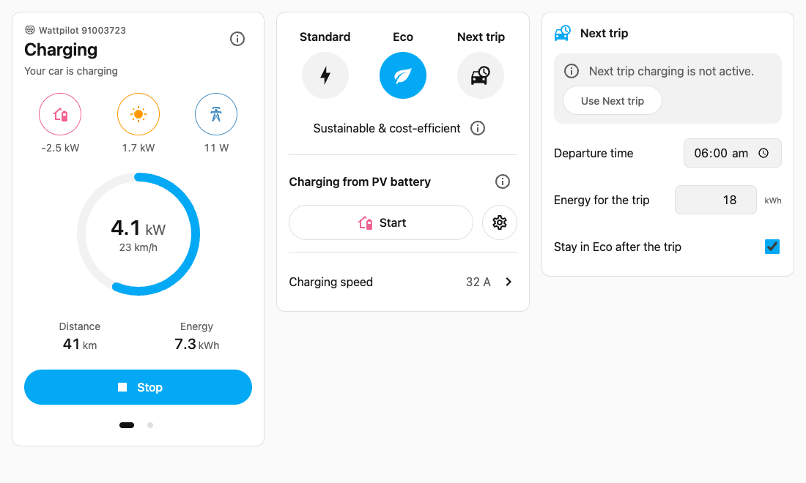

# Fronius Wattpilot Integration for Home Assistant

<!-- BADGES:START -->

[](https://www.hacs.xyz/docs/marketplace/)
[](https://github.com/tinkerologie/ha-wattpilot/commits/main)
[](https://github.com/tinkerologie/ha-wattpilot/releases)
[](https://codecov.io/gh/tinkerologie/ha-wattpilot)
[](./LICENSE)

<!-- BADGES:END -->

Custom Home Assistant integration for monitoring and controlling Fronius Wattpilot EV chargers using a reverse-engineered WebSocket API.

[](https://my.home-assistant.io/redirect/hacs_repository/?owner=tinkerologie&repository=ha-wattpilot&category=integration)

## Features

- **Dashboard cards**: three Lovelace cards for charging status, charging mode and the next trip. They ship with the integration and need no extra install.
- **Control**: switch between Standard (Default), Eco and Next trip, start and stop charging, set the charging current and the PV thresholds.
- **Live monitoring**: charging power per phase, session and total energy, car state, plus PV, grid and PV battery readings that the charger receives from a Fronius inverter.
- **Local or cloud**: connect over your LAN (websocket) or through the Fronius cloud.
- **Push updates**: the charger pushes every change, so entities update immediately without polling.

### Supported devices

Fronius Wattpilot Home 11 J, Wattpilot Home 22 J and Wattpilot Flex. Entities that a firmware or model does not provide are not created.

## Requirements

- Home Assistant **2026.9** or newer.
- The charger's password from the Wattpilot app (Settings → WiFi → Show password) or the sticker on the charger.

## Installation

### HACS (recommended)

[](https://my.home-assistant.io/redirect/hacs_repository/?owner=tinkerologie&repository=ha-wattpilot&category=integration)

1. Open HACS and search for **Fronius Wattpilot** (or add `https://github.com/tinkerologie/ha-wattpilot` as a custom repository of type _Integration_).
2. Download it and restart Home Assistant.

### Manual

1. Download the latest release from the [Releases](https://github.com/tinkerologie/ha-wattpilot/releases) page.
2. Copy the `wattpilot` folder to `config/custom_components/`.
3. Restart Home Assistant.

## Configuration

[](https://my.home-assistant.io/redirect/config_flow_start/?domain=wattpilot)

Chargers on your network are **discovered automatically** (zeroconf): Home Assistant shows a _Discovered_ card, and you only enter the charger password. If the charger later gets a new IP address, discovery updates the integration for you.

To add a charger manually, go to **Settings → Devices & services → Add integration → Fronius Wattpilot** and choose how to connect:

| Field                      | Local network                                | Fronius cloud               |
| -------------------------- | -------------------------------------------- | --------------------------- |
| Name                       | Display name of the charger                  | Display name of the charger |
| IP address / Serial number | The charger's IP address                     | The 8-digit serial number   |
| Password                   | The charger password                         | The charger password        |
| Connection timeout         | Seconds to wait for the charger (default 15) | Same                        |

Home Assistant connects once before saving, so a wrong address or password is reported straight away. Each charger can be added only once.

- **Change the address or password later**: open the integration, then **⋮ → Reconfigure**. Leave the password empty to keep the current one.
- **Password changed on the charger**: Home Assistant shows a _Reauthentication required_ notice; enter the new password there.

### Removal

Go to **Settings → Devices & services → Fronius Wattpilot**, open the **⋮** menu of the charger and select **Delete**. Then remove the integration from HACS if you no longer need it. Dashboard cards that used the charger show a "No Wattpilot charger found" notice until you remove them.

## Dashboard cards

The integration registers its cards automatically. In a dashboard, choose **Add card** and search for _Wattpilot_. Every card has a visual editor: pick the charger and the card finds its entities by itself.

| Card                              | Shows                                                                                                                                                                                                                                                                                                 |
| --------------------------------- | ----------------------------------------------------------------------------------------------------------------------------------------------------------------------------------------------------------------------------------------------------------------------------------------------------- |
| `custom:wattpilot-charger-card`   | Charging status, a live power ring with the km/h being added, session distance and energy, Start/Stop, solar/battery/grid power and a second page with the PV quick settings (PV surplus and battery thresholds). The ⓘ button shows current, voltage and power factor per phase and the cable limit. |
| `custom:wattpilot-mode-card`      | Standard, Eco and Next trip as large buttons, charging from the PV battery, the charging current and (optionally) the phase mode.                                                                                                                                                                     |
| `custom:wattpilot-next-trip-card` | Departure time, the energy needed for the trip and the _stay in Eco_ switch, with a one-tap way to switch to Next trip mode.                                                                                                                                                                          |



Example YAML:

```yaml
type: custom:wattpilot-charger-card
device_id: 1625eec2e3f83829c2d52999ecdd2036
consumption: 17.5 # kWh/100 km, used for distance and km/h
show_power_flow: true
show_pv_settings: true
show_force_start: false
confirm_force_start: true
```

All cards accept `title` and an optional `entities` map to override a detected entity, for example `entities: {charging_power: sensor.my_power}`. Distances follow the Home Assistant unit system (km or mi). The cards follow your theme, support light and dark mode, keyboard navigation and screen readers, and are translated to English and German.

Sections that depend on optional entities hide themselves. For example, _Charging from PV battery_ appears once you enable the **Discharge PV battery** entity (disabled by default, firmware 41.7+).

## Entities

| Platform      | Examples                                                                                                                                                                                                            |
| ------------- | ------------------------------------------------------------------------------------------------------------------------------------------------------------------------------------------------------------------- |
| Sensor        | Car state, charging power (per-phase attributes), session energy, total energy, charging reason, phases in use, PV power, grid power, PV battery power and state of charge, cable current limit, temperature, Wi-Fi |
| Binary sensor | Plug connected, charging                                                                                                                                                                                            |
| Button        | Start charging, stop charging, force start, restart                                                                                                                                                                 |
| Number        | Max charging current, start charging at (PV surplus), PV battery threshold, next trip energy, phase switch timing                                                                                                   |
| Select        | Charging mode, phase switch mode, cable unlock, access control                                                                                                                                                      |
| Switch        | PV surplus charging, remain in Eco, discharge PV battery, boost and more                                                                                                                                            |
| Time          | Next trip departure time                                                                                                                                                                                            |
| Update        | Charger firmware                                                                                                                                                                                                    |

PV, grid and battery sensors only appear when the charger is linked to a Fronius inverter.

### How data is updated

The charger keeps a websocket open to Home Assistant and pushes every property change. Entities update as soon as the charger reports a change; there is no polling interval. If the connection drops, the client reconnects automatically and entities show as unavailable in the meantime.

## Actions

| Action                         | Fields                      | What it does                                                                                   |
| ------------------------------ | --------------------------- | ---------------------------------------------------------------------------------------------- |
| `wattpilot.set_next_trip`      | `device_id`, `trigger_time` | Sets the next trip departure time.                                                             |
| `wattpilot.set_goe_cloud`      | `device_id`, `cloud_api`    | Turns the go-e cloud API on or off. When turned on, the response contains the API key and URL. |
| `wattpilot.disconnect_charger` | `device_id`                 | Closes the connection (entities become unavailable).                                           |
| `wattpilot.reconnect_charger`  | `device_id`                 | Reconnects a disconnected charger.                                                             |

Invalid input (for example an unknown device) raises a validation error in the UI; failures reported by the charger raise an error with the charger's message. The same applies to entities: if the charger rejects a switch, number, select, button or time change, Home Assistant shows an error instead of silently keeping the old value.

### Example: charge for the morning trip

```yaml
automation:
  - alias: Wattpilot next trip from calendar time
    triggers:
      - trigger: state
        entity_id: input_datetime.departure
    actions:
      - action: wattpilot.set_next_trip
        data:
          device_id: 1625eec2e3f83829c2d52999ecdd2036
          trigger_time: "{{ states('input_datetime.departure') }}"
```

### Use cases

- **Solar surplus charging**: select Eco, enable _PV surplus_, and set _Start charging at_ to the surplus that should start a charge. The charger card's PV page shows the current surplus next to the threshold.
- **Ready by departure**: select Next trip and set the departure time and energy in the next trip card; the charger plans the cheapest or greenest window.

## Known limitations

- The websocket API is reverse-engineered and can change with charger firmware updates.
- The weekly schedule and the vehicle state of charge from the Wattpilot app are not available through this API.
- PV, grid and battery values are the readings the inverter shares with the charger; they are not a replacement for the inverter integration.

## Troubleshooting

**Cannot connect (local)**: check the IP address, that Home Assistant can reach the charger, and the password from the Wattpilot app.

**Cannot connect (cloud)**: check the serial number and that the charger is online in the Wattpilot app.

**Entities unavailable**: check the logs, then use the `wattpilot.reconnect_charger` action or reload the integration.

**Cards not in the card picker**: reload the browser with a cleared cache. The card bundle is served from `/wattpilot/wattpilot-cards.js`.

### Debug logging

```yaml
logger:
  default: info
  logs:
    custom_components.wattpilot: debug
    wattpilot_api: debug
```

## Contributing

See [CONTRIBUTING.md](CONTRIBUTING.md).

## Credits

Based on the excellent work by [@joscha82](https://github.com/joscha82) on the [wattpilot python module](https://github.com/joscha82/wattpilot).

Originally developed by [@mk-maddin](https://github.com/mk-maddin).

## Disclaimer

This integration is not officially associated with or endorsed by Fronius. Fronius trademarks belong to Fronius International GmbH. This integration is independently developed using a reverse-engineered API and may stop working at any time.

**Use at your own risk.** Neither the contributors nor maintainers are responsible for any damage caused by this integration.

## License

This project is licensed under the Apache License 2.0 - see the [LICENSE](LICENSE) file for details.

Copyright (c) 2023 @mk-maddin - Original Author
Copyright (c) 2024-2025 @ruaan-deysel - Current Maintainer

See [NOTICE](NOTICE) file for additional attribution information.
